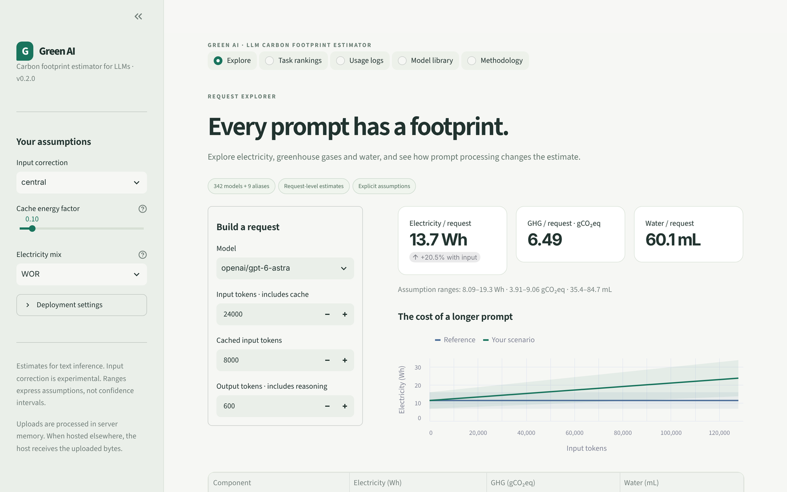
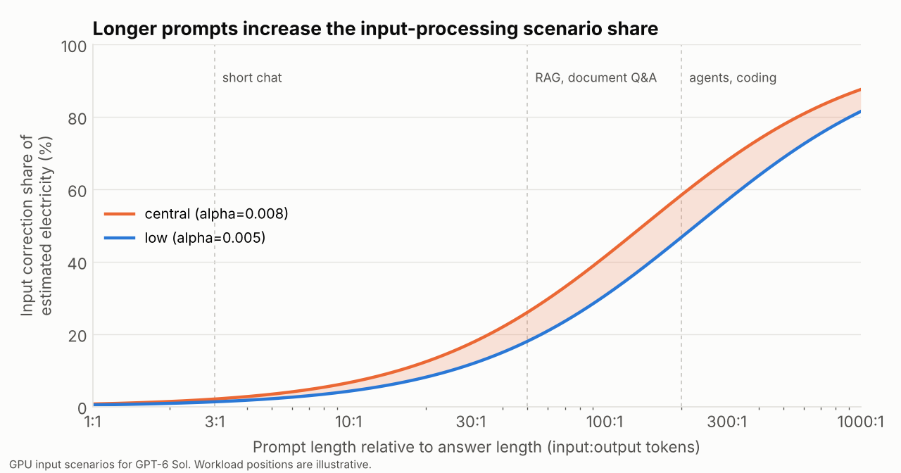
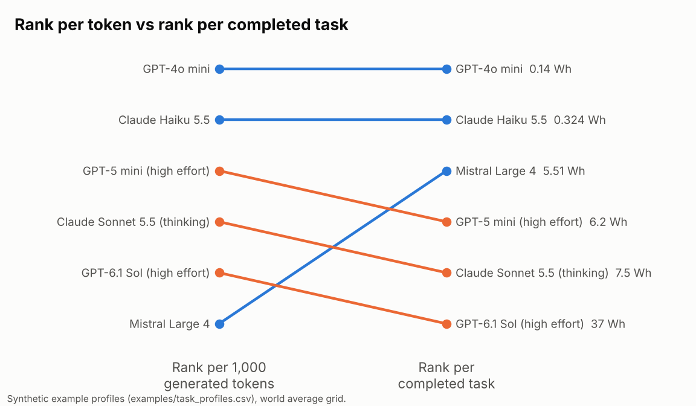
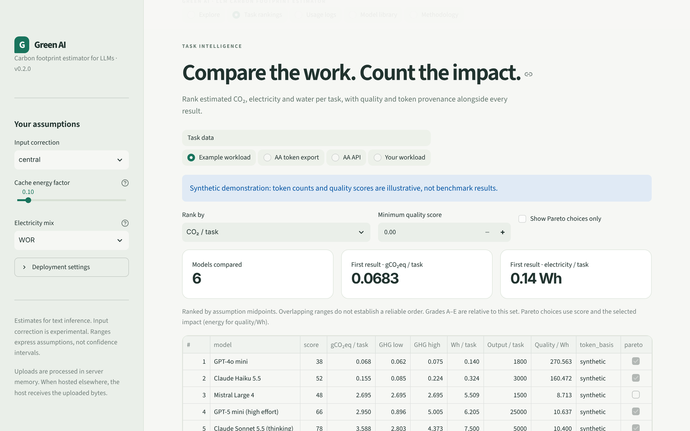
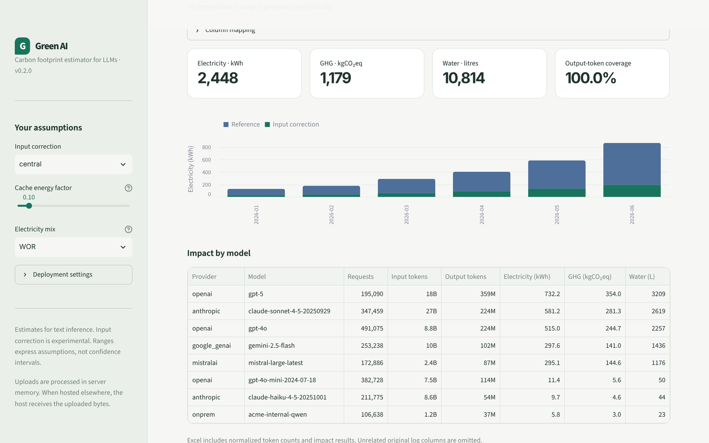

<div align="center">

# Green AI

**Carbon footprint estimator for LLMs**

Electricity, CO₂ and water of large language model usage, per request, per task
and per usage log, counting the prompt as well as the answer.

[](https://github.com/georgiostsokas/green-ai/actions/workflows/ci.yml)




</div>

## Why

Most footprint estimates for LLM API calls are driven by the number of
**generated** tokens. Two things fall through the cracks.

1. **The prompt.** Reading the prompt (the *prefill* phase) also uses GPU energy.
   RAG pipelines, coding assistants and agents now send 30 to 300 prompt tokens
   for every token they get back.
2. **The task.** A model that is cheap per token can still be expensive per job.
   Reasoning models often spend several times more tokens on the same task.

Green AI estimates both, keeps every assumption visible, and runs on real usage
logs.

<p align="center"></p>

## What it does

| | |
|---|---|
| **Request explorer** | Electricity, GHG and water for one request, with the effect of prompt length and caching. |
| **Task rankings** | Footprint per completed task, reasoning and multi call agents included, score per Wh, and how the ranking changes compared with per token figures. |
| **Usage analytics** | Monthly and per model totals from your own logs (CSV, Excel, JSON, Parquet), with coverage reporting and an Excel export. |
| **Model library** | 342 models and 215 electricity mixes, refreshed by a weekly sync. |
| **CLI and Python API** | Everything above from the terminal or code, plus a tracker for OpenAI, Anthropic, Mistral and Gemini responses. |

## Quick start

**macOS:** double-click `Open_Green_AI.command`. **Windows:** double-click
`Open_Green_AI.bat`. The first launch installs what it needs in a local `.venv`,
then the dashboard opens at http://127.0.0.1:8501 on your own computer.

From a terminal:

```bash
git clone https://github.com/georgiostsokas/green-ai && cd green-ai
python3 -m venv .venv && source .venv/bin/activate
pip install -e ".[app]"
green-ai app
```

Synthetic examples are built in, so every view works without API keys or data.

## Per task, not per token

<p align="center"></p>

A per token ranking rewards models that are efficient per token, even when they
need many more tokens to finish the job. Ranked per completed task, reasoning
heavy configurations drop and a lean model can move up. The figure uses the
synthetic workload in [`examples/task_profiles.csv`](examples/task_profiles.csv).

Task profiles can come from your own traces (average input, output and cached
tokens and calls per task) or from [Artificial Analysis](https://artificialanalysis.ai)
benchmark data. Profiles derived from cost rather than observed tokens are
labelled as such in every view and export ([details](docs/AA_INTEGRATION.md)).

```bash
green-ai tasks --csv examples/task_profiles.csv --by carbon --export ranking.csv
```

<p align="center"></p>

## Usage logs

```bash
green-ai batch usage.csv --custom examples/custom_models.yaml --zone FRA -o report/
```

Columns such as `model`, `prompt_tokens`, `completion_tokens`, `cached_tokens`,
`requests`, `date` and `provider` are detected automatically. Gateway, Azure,
Bedrock and Vertex style model names are matched to the registry, and anything
that cannot be matched is listed rather than dropped. Invalid counts stop the
analysis instead of turning into zeros. A million rows take about two seconds.

<p align="center"></p>

Self hosted and open weights models take a few lines of YAML, with their own
PUE, water and grid:

```yaml
providers:
  onprem: {location: FRA, pue: {min: 1.2, max: 1.5}, wue: 0.0}
models:
  - {name: glm-5.2, provider: onprem, total_params: 744, active_params: 40}
```

## Python

```python
from green_ai import Estimator

est = Estimator(zone="FRA")
e = est.estimate("claude-sonnet-5-5", input_tokens=60_000, cached_tokens=40_000, output_tokens=800)
print(e.total.energy_wh, e.total.gwp_g, e.prefill_share)
```

```console
$ green-ai estimate claude-sonnet-5-5 --in 60000 --cached 40000 --out 800
                    Reference (decode)        Prefill (central)                   Total
Energy         1.176 Wh (0.91 to 1.44)  0.2542 Wh (0.191 to 0.317)   1.43 Wh (1.1 to 1.76)
GHG       0.4782 gCO2eq (0.376 to 0.58)  0.0977 gCO2eq (0.073 to 0.12)  0.5759 gCO2eq (0.449 to 0.702)
Water          4.369 mL (2.96 to 5.78)  0.9467 mL (0.621 to 1.27)   5.316 mL (3.58 to 7.05)
Prompt processing share of energy: 18% (correction x1.22)
```

```python
from green_ai import Tracker

tracker = Tracker(zone="FRA")
tracker.add(response)  # the final response from the OpenAI, Anthropic, Mistral or Gemini SDK
print(tracker.summary())
```

## How it works

**Base model.** For each request: GPU energy per generated token from active
parameters and batch size, number of GPUs from total parameters, generation time
from provider throughput, host server energy by occupied time, datacenter PUE,
then emissions and water from the electricity mix, and embodied impacts
allocated by time. This follows the published EcoLogits methodology and matches
its reference code to floating point precision on 176,904 comparisons.

**Input correction.** Each prompt token counts as a fraction `alpha` of a
generated token's GPU energy, with cached tokens discounted:

```
extra GPU energy = alpha * (fresh_input + 0.1 * cached_input) * GPU energy per output token
```

PUE is applied once, and host energy and embodied impacts stay in the base
model. The presets come from public measurements:

| Preset | alpha | Source |
|---|---|---|
| `central` | 0.008 | median of 10 model and precision groups, about 100,000 requests on H100 ([arXiv:2601.22357](https://arxiv.org/abs/2601.22357), [dataset](https://huggingface.co/datasets/Anon152425/energy_dtype_all_models)) |
| `low` | 0.005 | mean of 20 published model and workload results ([arXiv:2602.05712](https://arxiv.org/abs/2602.05712)) |

`python scripts/reproduce_evidence.py` recomputes both from the bundled
aggregates.

**Per task.** The same model applied to the average tokens and calls of one
completed task.

Every result carries a range from undisclosed model sizes and datacenter
assumptions. More in [methodology](docs/METHODOLOGY.md),
[design notes](docs/DESIGN.md) and [validation](docs/VALIDATION.md).

## Roadmap

- Hourly grid carbon intensity instead of annual country averages.
- Provider specific deployment profiles (hardware generation, region).
- Calibration of `alpha` against metered prefill and decode energy at production
  batch sizes. Measurements are very welcome, see [CONTRIBUTING](CONTRIBUTING.md).
- Image and video generation models.

## Development

```bash
pip install -e ".[dev]"
pytest
ruff check . && ruff format --check .
python scripts/make_figures.py
```

`green-ai update` pulls newly released model data between versions, and the
[`sync-registry`](.github/workflows/sync-registry.yml) workflow refreshes the
bundled data weekly and opens a pull request after the tests pass. Hosting the
dashboard is covered in [DEPLOY.md](docs/DEPLOY.md).

## Acknowledgements

Inspired by [EcoLogits](https://ecologits.ai) (GenAI Impact). The base model
follows its published methodology, and the model and electricity data come from
its open dataset (MPL-2.0). Benchmark data, when you choose to load it:
[Artificial Analysis](https://artificialanalysis.ai).

## License

MIT for the code. Files in `src/green_ai/data/ecologits/` keep their Mozilla
Public License 2.0. Citation details are in [`CITATION.cff`](CITATION.cff).
